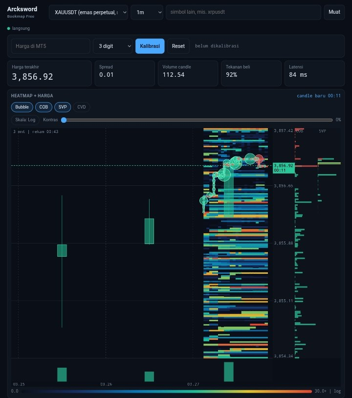

<div align="center">



<br>

<a href="https://crackdoom-dev.github.io/arcksword-bookmap/">
  
</a>

<sub>Langsung jalan di browser. Tanpa install, tanpa akun.</sub>

</div>

<br>

## Apa ini

Chart harga biasa cuma menunjukkan apa yang sudah terjadi. Arcksword Bookmap menunjukkan apa yang sedang antre: order beli dan jual yang menunggu di tiap level harga, digambar jadi peta warna yang bergeser ke kiri seiring waktu. Merah dan kuning berarti tebal, biru berarti tipis.

Candle dan transaksi digambar di atasnya, jadi kamu bisa lihat harga menabrak tembok order, mantul, atau menembusnya.

Semuanya jalan di browser. Data diambil langsung dari Binance, tidak lewat server saya.

<div align="center">
  
</div>

## Isinya

| | |
|---|---|
| **Heatmap** | Order book 500 level, direkam tiap 2 detik, dengan skala Log atau Linear |
| **Kontras** | Slider untuk menyembunyikan order kecil, plus legenda warna di bawah chart |
| **Sentuh level** | Ketuk chart untuk lihat harga, jam, sisi bid/ask, dan ketebalan ordernya |
| **Candle** | Candle asli Binance, atau candle mikro dari transaksi saat jendelanya masih pendek |
| **Bubble** | Gelembung transaksi, hijau beli agresif, merah jual agresif, ukuran sesuai volume |
| **COB, SVP, CVD** | Order book saat ini, volume per level harga, dan selisih beli-jual kumulatif |
| **Garis harga** | Harga terakhir dengan hitung mundur sampai candle berikutnya |
| **Kalibrasi MT5** | Samakan harga dengan broker kamu, mendukung 2 dan 3 digit |

Simbol bawaannya **XAUUSDT** (emas perpetual di Binance Futures), karena paling dekat dengan XAUUSD. PAXG, BTC, ETH, dan SOL ada di dropdown, simbol lain bisa diketik sendiri.

## Samakan dengan harga MT5

Harga Binance dan harga broker hampir selalu selisih beberapa dolar, dan selisihnya berubah-ubah.

1. Lihat harga di MT5.
2. Ketik di kolom **Harga di MT5**, pilih 2 atau 3 digit sesuai broker.
3. Tekan **Kalibrasi**.

Seluruh harga di bookmap langsung bergeser ke skala MT5. Selisih tidak tetap, jadi kalau teksnya berubah merah, kalibrasi ulang.

## Jalankan sendiri

Butuh Node.js 18 ke atas. Di Termux: `pkg install nodejs`.

```bash
npm install
npm run dev
```

Buka alamat yang muncul, biasanya `http://localhost:5173`. Mau dibuka dari perangkat lain di wifi yang sama, pakai `npm run dev -- --host`.

Untuk membangun versi siap upload: `npm run build`, hasilnya ada di folder `dist`.

## Yang perlu diketahui

- Binance tidak menyediakan riwayat order book. Heatmap, SVP, dan CVD baru terisi setelah halaman dibuka, dan hanya menyimpan 30 menit terakhir. Biarkan terbuka beberapa menit dan hasilnya jauh lebih bagus.
- Sumber datanya Binance, bukan feed broker kamu. Volume dan order book mewakili pasar Binance.
- Kalau jaringanmu memblokir Binance, halaman akan menampilkan pesan gagal terhubung.
- Ini alat bantu baca pasar, bukan saran trading.

## Dibuat dengan

JavaScript biasa, canvas, dan [Vite](https://vitejs.dev). Tanpa framework, tanpa server. Data dari API publik Binance lewat REST dan WebSocket.

Nama "Arcksword Bookmap" adalah nama proyek pribadi dan tidak berafiliasi dengan produk komersial mana pun yang memakai nama serupa.

<div align="center">
<br>
<sub>dibuat oleh <a href="https://github.com/CrackDoom-dev">CrackDoom-dev</a></sub>
</div>
